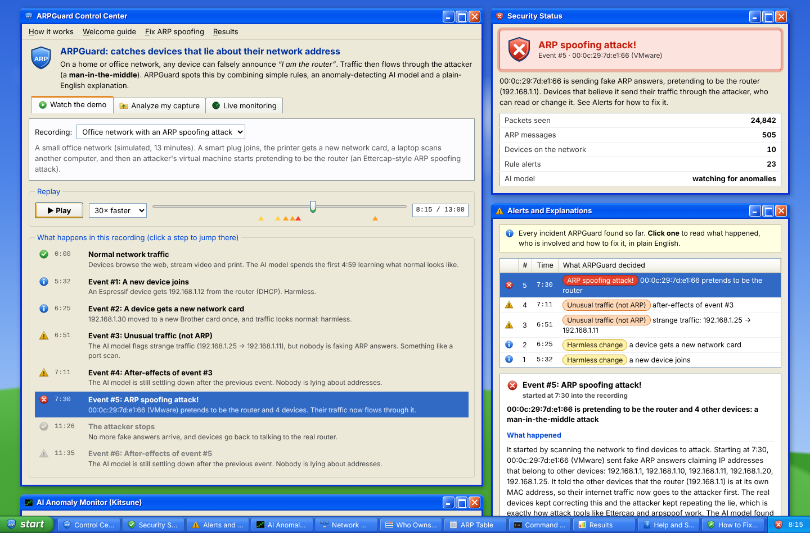

# ARPGuard

AI-assisted ARP spoofing detection for a networking course (Module III: Ethernet & ARP).

ARP has no authentication: any host on a LAN can claim any IP, including the gateway's, and quietly
put itself in the middle of everyone's traffic. ARPGuard watches ARP and the traffic around it and
flags spoofing with three parts:

1. **Rule engine.** An IP→MAC binding table with explainable checks: gateway MAC change, IP conflicts,
   flip-flopping bindings, one MAC claiming many IPs, unsolicited replies, Ethernet/ARP mismatch,
   ARP scans and floods, and DHCP-backed changes (DHCP snooping, in software).
2. **Kitsune (KitNET).** A published unsupervised anomaly detector (Mirsky et al., NDSS 2018), vendored
   from the authors' code. It calibrates itself on the first packets of a capture; nothing is trained offline.
3. **Verdict fusion and an LLM referee.** A small table combines the rule and model evidence into a verdict.
   An LLM (Claude, or a local model via Ollama) explains each incident in plain English with fixes. **The
   LLM never decides a verdict**: it only sees the evidence the code produced, and its output is checked
   against that evidence.

**Live demo: https://arpguard.vercel.app**

The dashboard looks like a Windows XP desktop, and every part of it explains itself in plain English:

* **Welcome guide.** A 4-step wizard on first visit covers what ARP is, how the attack works, how ARPGuard
  catches it and how to use the page.
* **Control Center.** Replay a recording, upload your own capture or start live monitoring. A "story" list
  tells you what happens in the recording; click a step to jump there.
* **Security Status.** A green, yellow or red shield with one sentence saying what the current verdict means.
  A notification balloon pops up from the taskbar when something happens.
* **Alerts and Explanations.** Every incident, with what happened, who the attacker is, who's affected, why it
  matters and how to fix it.
* **AI Anomaly Monitor**, a Task-Manager-style graph of the Kitsune score with the alarm line. **Who Owns Each
  Address?** shows each IP's owner over time, Disk-Defragmenter style. Also: the **ARP table**, a **network
  map** showing the detour through the attacker, and a **Command Prompt** of raw ARP messages.
* **Help and Support** (basics, how it works, verdicts, rules, glossary), **How to Fix ARP Spoofing** and
  **Results**, all from the start menu.
* Working minimize, maximize and close buttons, a taskbar, and the Blue, Olive and Silver color schemes.



```
 Input                 Detection                         Explanation        Output
┌──────────────┐   ┌───────────────────────────┐   ┌───────────────┐   ┌───────────┐
│ .pcap upload │──▶│ Rule engine (IP↔MAC table) │──▶│               │   │           │
│ Live sniff   │   │                           │   │ Verdict fusion │──▶│ LLM       │──▶ Dashboard
│ (own LAN)    │──▶│ Kitsune (anomaly score)    │──▶│               │   │ explainer │
└──────────────┘   └───────────────────────────┘   └───────────────┘   └───────────┘
```

## Quick start (local)

```bash
python -m venv .venv && . .venv/bin/activate      # Windows: .venv\Scripts\activate
pip install -r requirements-dev.txt

python -m arpguard serve                  # dashboard + API on http://localhost:8000
python -m arpguard analyze data/arp_mitm_synthetic.pcap --json out.json
sudo python -m arpguard serve             # with sniffing rights: the Live tab works
sudo python -m arpguard live --record data/home_benign.pcap   # headless; saves a benign capture
pytest                                    # 34 tests, about 4 s
```

Set `ANTHROPIC_API_KEY` to get Claude explanations; without it ARPGuard uses deterministic
template explanations built from the same evidence. For offline use, set `ARPGUARD_LLM=ollama`
(plus `OLLAMA_HOST` and `OLLAMA_MODEL`).

Live mode needs raw-socket rights (root, or Administrator with Npcap on Windows). **Only sniff networks you
own or administer.** Don't run it on college Wi-Fi; the bundled captures cover the attack side.

## The three modes

| Mode | What happens |
|---|---|
| **Replay demo** | Precomputed results for the bundled captures replay in the browser at 1-100x speed. Scrub, jump to the next incident, expand the referee's notes. |
| **Upload a capture** | `POST /api/analyze` runs the full pipeline on a `.pcap`/`.pcapng`/`.gz` (up to 4.4 MB and 60k packets on Vercel; files over the limit are gzipped in the browser first) and the result replays like the demo. |
| **Live (your LAN)** | Local only. Scapy sniffs, the same pipeline runs, and the dashboard follows the session. |

## Verdict fusion

| Rule alert | Kitsune | Verdict |
|---|---|---|
| Gateway conflict / flip-flop (high, critical) | High | 🔴 **Confirmed spoofing** |
| Other IP conflict (medium) | High | 🔴 **Probable spoofing** |
| Flip-flopping (repeated re-poisoning) | Low | 🟠 **Suspicious, review** |
| Any one-off conflict (DHCP change, NIC swap, router replaced) | Low | 🟡 **Likely legitimate** (log only, and the new MAC becomes trusted) |
| None | High | 🟠 **Anomaly, not ARP-related** |
| None | Low | 🟢 Normal |

"Kitsune high" means at least 3 packets in the incident's window (2 s before to 10 s after its ARP
activity) score above the threshold **and** they make up at least 20% of that window. A single noisy
packet can't flip a verdict, but traffic relayed through an attacker does. Verdicts are causal: an
incident reads "pending" until the evidence is in, and a spoofing verdict is never downgraded. When a
Kitsune-only anomaly starts shortly after another incident and involves the same hosts, it's linked as an
after-effect (Kitsune's slow-decaying statistics take a while to settle).

## Results

Measured on per-packet labels with no training involved (`python scripts/build_demo.py` regenerates
`eval/RESULTS.md`). Every method is scored on the packets after Kitsune's grace period.

**Attack capture** (`data/arp_mitm_synthetic.pcap`, 28,787 packets scored, 16,194 malicious):

| Method | Detection | FPR | Precision | F1 | Time to detect |
|---|---|---|---|---|---|
| Rules only | 0.996 | 1.08% | 0.992 | **0.994** | 0.2 s |
| Kitsune only (p99 × 1.1) | 0.623 | 33.6% | 0.705 | 0.661 | 0.1 s |
| Kitsune only (max × 1.1, plan rule) | 0.308 | 13.5% | 0.746 | 0.436 | 3.0 s |
| **Combined (ARPGuard)** | 0.983 | **0.00%** | **1.000** | 0.992 | 2.3 s |

**Benign capture** (`data/home_benign_synthetic.pcap`, no attack, includes a router replacement):
false alarms are **17.8%** of packets for rules only, 1.3% for Kitsune (p99), 0% for Kitsune (max)
and **0%** combined.

What this shows, honestly:

* On a textbook attack the rules alone already catch nearly everything. Fusion **matches** their F1
  rather than beating it, and confirms about 2 s later because it waits for the model's evidence.
* Fusion's value is false alarms. A NIC swap or a replaced router looks exactly like spoofing to the
  rules (17.8% of benign packets flagged); the combined system raised none on either capture.
* Kitsune alone flags a lot that isn't ARP spoofing: a port scan, and its own after-effects. That's
  why it's combined with the rules rather than used on its own.
* **The plan's threshold rule (highest calibration score × 1.1) is fragile.** The maximum of a few
  thousand benign scores is just its single largest outlier: on two generations of the same synthetic
  capture it caught 0.2% and then 31% of attack packets. The default is therefore the 99th
  percentile × 1.1; `--threshold max` keeps the plan's rule available.
* **These captures are synthetic** (`scripts/make_synthetic_capture.py`). They show the method works
  end to end, not how well it generalises. For the report, run the evaluation on the real Kitsune
  capture:

```bash
python scripts/fetch_kitsune.py           # or --zip path/to/downloaded/kitsune.zip
python -m eval.evaluate data/kitsune/ARP_MitM_pcap.pcapng --labels data/kitsune/ARP_MitM_labels.csv --limit 200000
```

(Python Kitsune runs at about 700 packets/s, so 200k packets take about 5 minutes. The download script
couldn't be tested from the environment this was built in; it prints what it extracts.)

## Deploying to Vercel

The repo is a Vercel FastAPI project: `app.py` exposes the API, the CDN serves `public/`, and
`vercel.json` sets a 300 s function limit and keeps the captures and tests out of the bundle.
Connect the GitHub repo in Vercel (framework preset: FastAPI) and add one environment variable:

| Variable | Purpose |
|---|---|
| `ANTHROPIC_API_KEY` | Enables the "Ask the AI referee" button (Claude Opus 5.5 with structured output). Optional. |
| `ARPGUARD_EXPLAIN_PER_MINUTE` | Per-IP limit on LLM explanations (default 6), so a public demo can't run up your bill. |
| `ARPGUARD_MAX_PACKETS` | Packet cap per upload (default 60,000). |

Live sniffing can't run on Vercel (no raw sockets); the Live tab explains how to run it locally.

## Project layout

```
app.py                   Vercel entrypoint
arpguard/
  core/  parser.py       pcap/pcapng/gzip → Packet: Ethernet II, 802.1Q, ARP (0x0806), IPv4, DHCP, IPv6
         detector.py     rule engine and binding table
         fusion.py       verdict fusion and incidents
         oui.py          MAC vendor (OUI) lookup, unicast/multicast/locally-administered bits
         live.py         Scapy live sniffer
  ml/    kitsune/        vendored Kitsune-py (MIT): NumPy 2 fixes, SciPy optional; see its README
         kitsune_runner.py  grace period, calibration, threshold
  ai/    explainer.py    evidence builder, Claude/Ollama/template providers, guardrails
  api/   main.py         FastAPI: /api/health, /api/analyze, /api/explain, /api/live/*
  pipeline.py            Session: packets → rules + Kitsune → fusion → result JSON
public/                  the dashboard (plain HTML/CSS/JS, XP-style theme), plus precomputed demo data in data/
data/                    synthetic labelled captures (see data/README.md)
eval/evaluate.py         rules vs Kitsune vs combined: detection rate, FPR, P/R/F1, time-to-detect
scripts/                 make_synthetic_capture.py, build_demo.py, fetch_kitsune.py
tests/                   pytest suite
report/                  screenshots and figures for the write-up
```

## Syllabus coverage (Module III)

| Topic | Where |
|---|---|
| Ethernet frames | `parser.py` decodes Ethernet II headers, 802.1Q tags and EtherTypes (0x0806 ARP, 0x0800 IPv4, 0x86DD IPv6) |
| Ethernet MAC | `oui.py`: unicast/multicast/broadcast and locally administered bits, OUI vendor lookup (a VMware OUI often means an attacker VM) |
| ARP | the live ARP table, request/reply/gratuitous/probe tracking, the binding history timeline |
| ARP issues | spoofing, poisoning, MitM, flip-flops, ARP scans and broadcast floods |
| LAN switches | mitigations: Dynamic ARP Inspection, DHCP snooping, port security, with IOS commands |
| IPv4 | IP→MAC binding analysis, gateway inference (DHCP router option or next-hop MAC), relayed-traffic detection |
| IPv6 | NDP has the same weakness (spoofed Neighbor Advertisements): future work |

## Viva demo (5 minutes)

1. Open the site and click through the **Welcome guide** (or start from step 2).
2. Press **▶ Play** at 10x: a normal LAN while Kitsune learns (the gray area of the anomaly graph).
3. 5:32: a smart plug gets .12 from DHCP. The rule fires, but traffic is normal: *harmless change*.
4. 6:51: a port scan. The AI graph spikes but no ARP rule fires: *unusual traffic (not ARP)*.
5. 7:30: the Ettercap attack. An ARP scan, then the router's MAC flips to a VMware MAC. The rules fire, the
   score crosses the alarm line, the shield turns red, a balloon pops up and the network map shows the detour:
   *ARP spoofing attack!* Open **Alerts and Explanations** for the attacker, the victims and the fixes.
6. Switch the recording to the no-attack one: the router swap comes out as harmless. Then open **Results**.

## Limitations

* Kitsune is a general anomaly detector, not an ARP-specific one; it flags port scans, new devices and its
  own after-effects. That's the reason for the fusion.
* "Trusted" means the first MAC seen for an IP (or the DHCP-assigned one). If a capture starts mid-attack,
  the attacker's binding is trusted first, though the multi-IP and flip-flop rules still catch it.
* A router replacement and a one-shot spoof of a silent gateway look the same to both detectors.
* Python Kitsune is slow (about 700 packets/s); analyse slices of large captures.

## Credits

Kitsune and KitNET: Yisroel Mirsky et al., *Kitsune: An Ensemble of Autoencoders for Online Network
Intrusion Detection*, NDSS 2018 ([code](https://github.com/ymirsky/Kitsune-py), MIT;
[dataset](https://archive.ics.uci.edu/dataset/516/kitsune+network+attack)).
The look is inspired by Windows XP's "Luna" theme. All icons and the wallpaper are original drawings
(CSS and SVG), with no Microsoft logos or image files.
